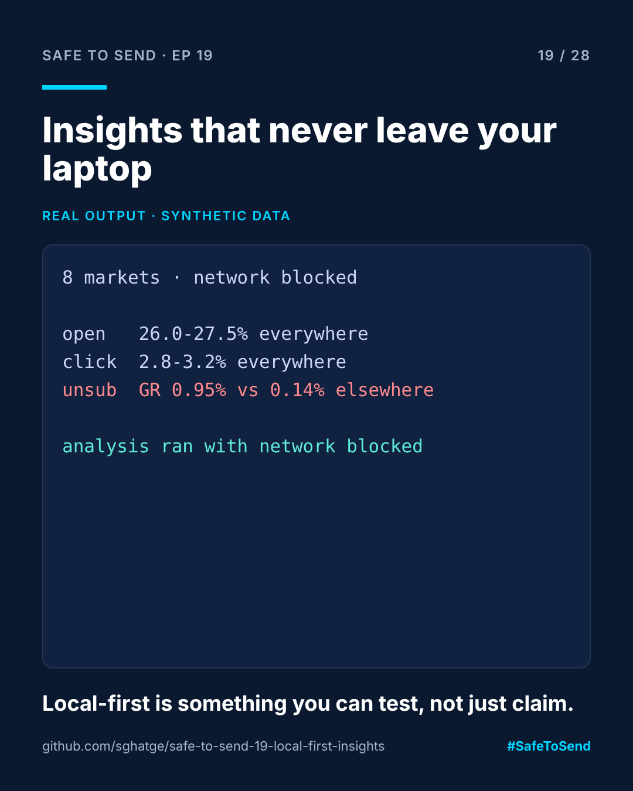

# safe-to-send-19 · Local-First Insights



**Safe to Send · Episode 19** — a 28-day learn-in-public series on governing AI in CRM operations.

> The fastest way to kill an AI tool in a marketing team: ask people to upload customer data to use it.

## The real-world scenario

An analyst wants help reading Black Friday results across eight markets. The only tool on offer is a web app that wants the CSV uploaded. Legal says no. The analyst goes back to a spreadsheet and a calculator, and the useful pattern in the data gets missed.

## The use case

Run the analysis locally, and prove it. Everything happens inside a `no_network()` guard that makes any outbound connection or DNS lookup raise an error, whether it comes from this code or from a library it imports. The test suite checks that guarantee on every push.

## Run it

```bash
python local_insights.py examples/black_friday_results.csv
```

## Real example output

```
| Market | Sent | Open | Click | Unsub |
|---|---|---|---|---|
| HR | 142,800 | 27.5% | 3.2% | 0.15% |
| HU | 274,000 | 27.0% | 3.2% | 0.14% |
| ...
| GR | 312,500 | 26.0% | 2.9% | 0.95% |
| RS | 168,400 | 26.0% | 2.9% | 0.14% |

- **GR** unsub rate 0.95% vs 0.14% for the other markets (z = +163.7)

(analysis ran with network access blocked)
```

Greece's open and click rates look normal, so a dashboard sorted by opens would bury it. Its unsubscribe rate is roughly seven times the other markets. (The z-score is huge because the synthetic markets are unrealistically similar; on real data, expect smaller numbers and use the threshold you trust.) A spike like this usually points at the send itself: timing, pricing or audience, the same defects pre-send QA exists to catch.

## Why leave-one-out

A normal z-score lets one extreme market inflate the spread and hide itself. Each market here is compared with the *other* markets only.

## Use the guard in your own tools

```python
from local_insights import no_network
with no_network():
    run_my_analysis()   # any network attempt raises NetworkBlocked
```

MIT · [Sangram Ghatge](https://www.linkedin.com/in/sangram-g-2369705b) · #SafeToSend
